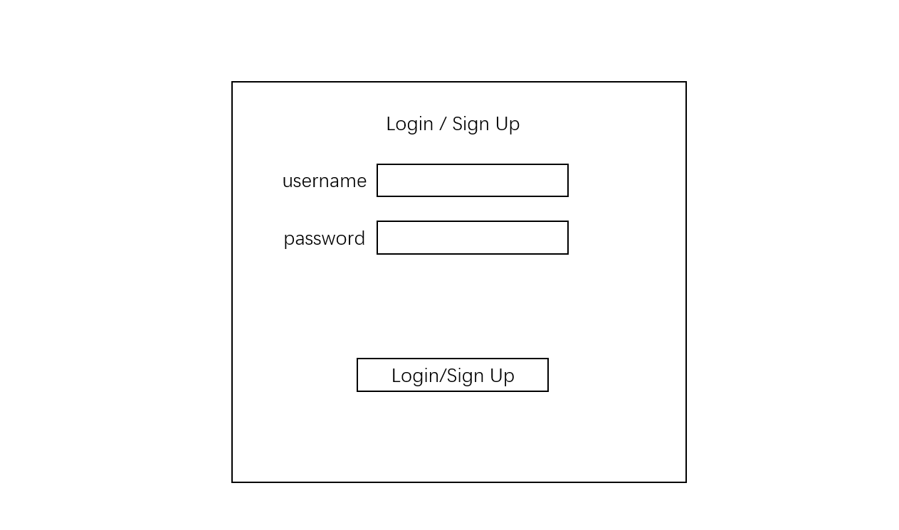
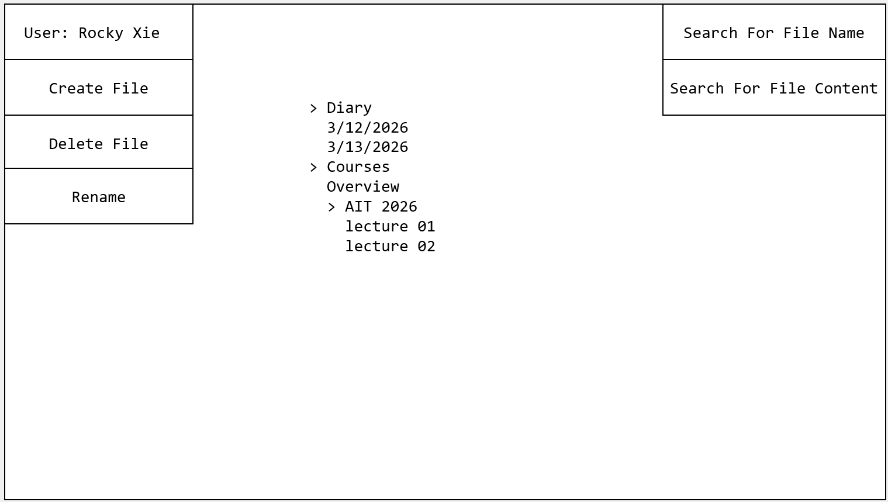
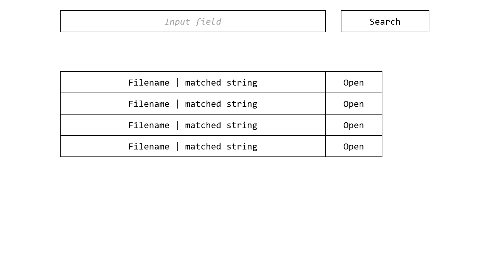
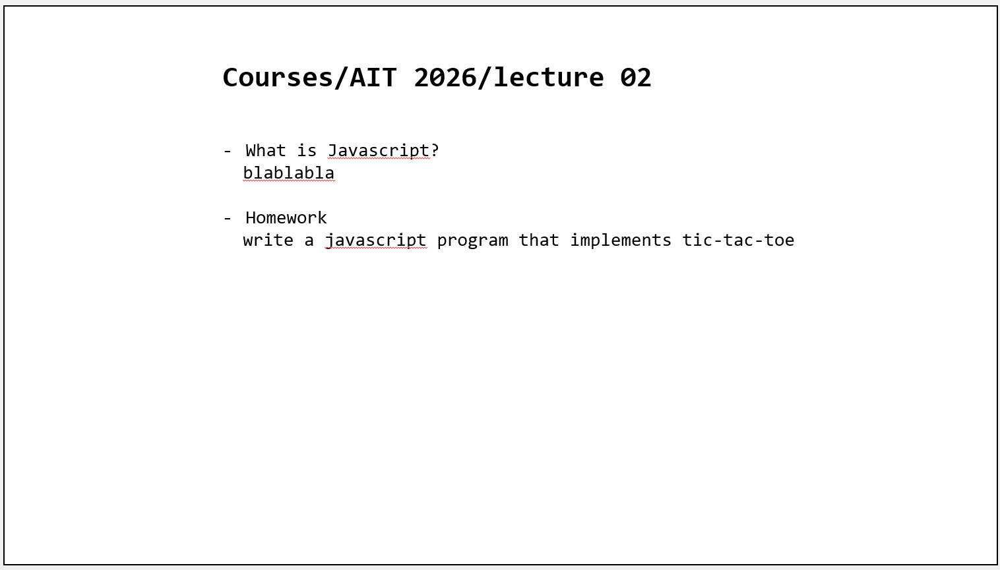
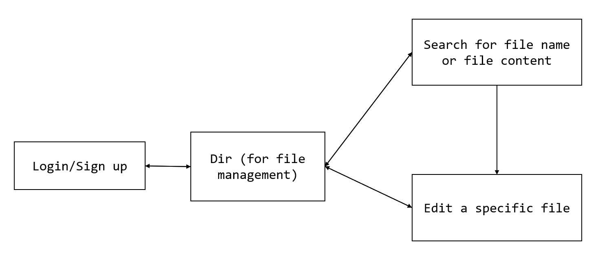

# NoteWeb

## Overview

This is a web application that allows users to take notes. Simply enter the username and password to login, and then you can take notes. It provides online storage and file management.

## Data Model

The application will store Users and the notes they have taken

* each note is stored as a file on the server side
* the database only stores the users' profile and a list of paths refering to the note files.

An Example User:

```javascript
{
  username: "shannonshopper",
  salt: "a salt",
  hash: // a password hash,
  files: ["note_for_ait", "diary/2026-3-12", "diary/2026-3-13"] // a list of paths refering to notes
}
```

## [Link to Commented First Draft Schema](src/db.js)

## Wireframes

/login - page for login / signup



/dir - page for note management



/search - page for searching for a file or file's content



/file - page for editing a specific file



## Site map



## User Stories or Use Cases

1. as non-registered user, I can register a new account with the site
2. as a user, I can log in to the site
3. as a user, I can create or delete files
4. as a user, I can view and edit all files
5. as a user, I can search for a specific file by name or by content with filters
6. as a user, I can log out

## Research Topics

* (5 points) Integrate user authentication
    * I'm going to be using passport for user authentication
    * This helps me to build a secure website in the future
    * see <code>cs.nyu.edu/~jversoza/ait-final/register</code> for register page
    * see <code>cs.nyu.edu/~jversoza/ait-final/login</code> for login page
* (5 points) vue.js
    * I will use vue.js as the frontend framework
    * It is helpful to learn if I am going to develop complicated web pages in the future


## [Link to Initial Main Project File](src/app.js) 

## Annotations / References Used

1. [passport.js authentication docs](http://passportjs.org/docs) - (add link to source code that was based on this)
2. [tutorial on vue.js](https://vuejs.org/v2/guide/) - (add link to source code that was based on this)
